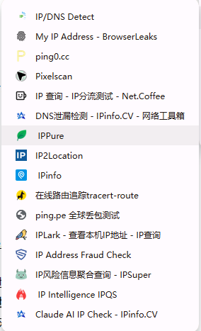
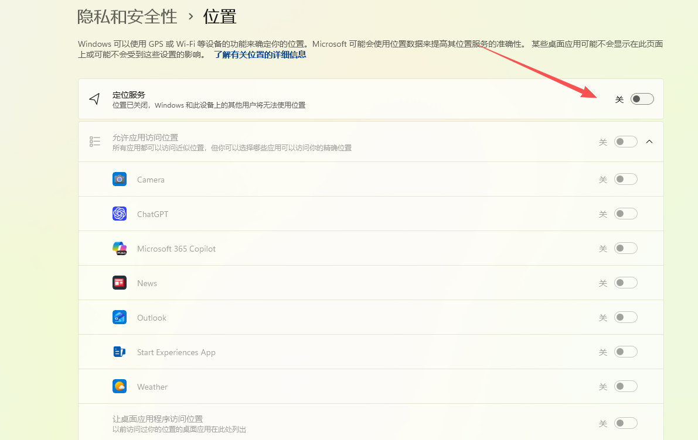
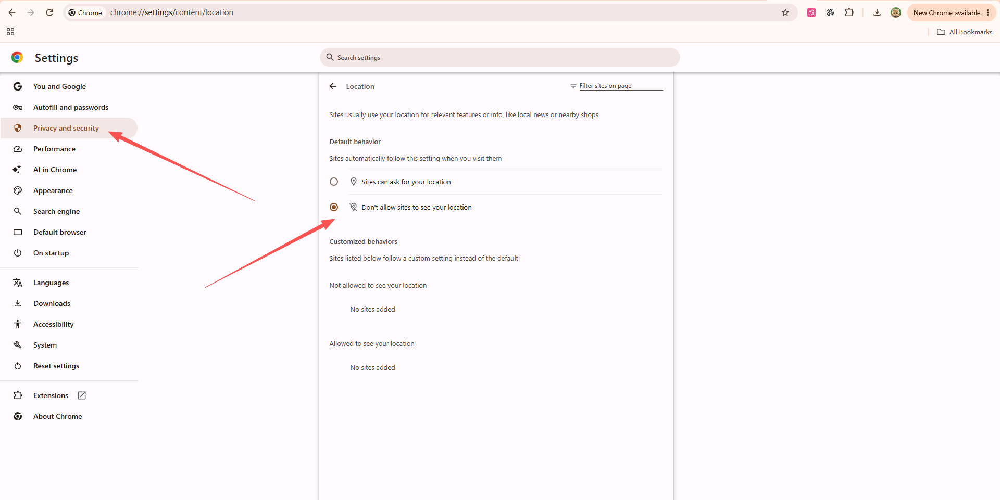
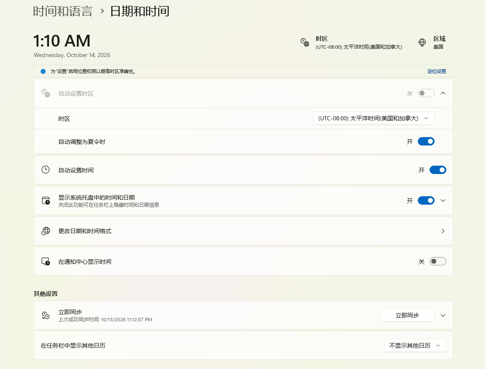
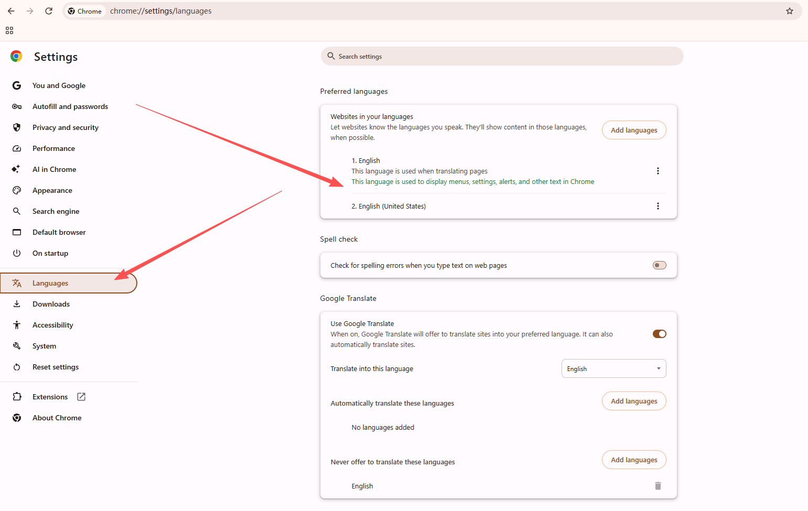
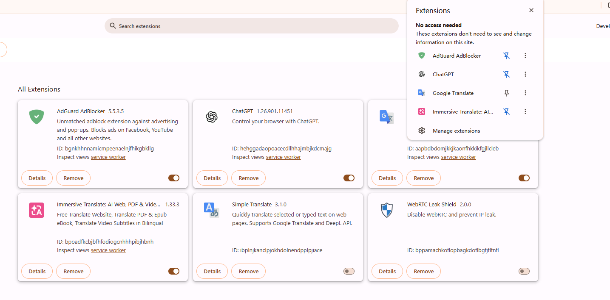
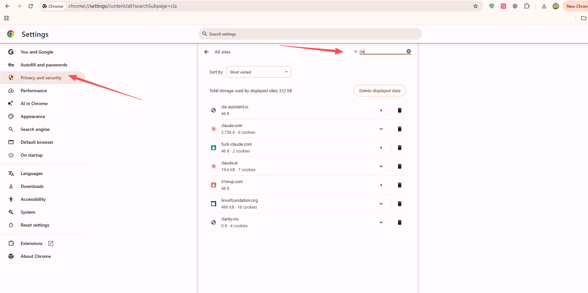
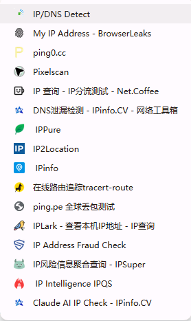
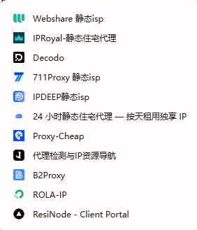
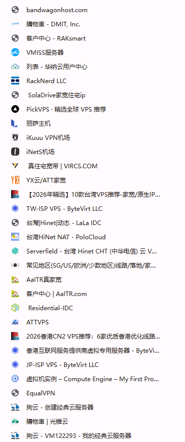

# Claude 防封，别只盯着 IP：我的使用心得分享

作者：Jasper · [X 原文与讨论](https://x.com/YztT13405/status/2110290282889809964) · [关注 Jasper](https://x.com/YztT13405)

这里同步的是公开分享版，后续更新和交流欢迎到 X 原帖。

**第一篇 X 长文，分享一点自己的使用心得。**

就聊聊 Claude。市面上不少常见的设置和方案，我都实际体验过。用下来，挑出适合自己的部分，慢慢组合成了现在这套配置。这次把我常用的电脑、浏览器和手机设置，以及不同客户端的使用心得整理出来，分享给有需要的小伙伴。

这篇就按我平时的使用顺序来写，中间也聊聊自己踩过的坑。大家可以参考，再按自己的设备和习惯调整。

先聊聊 Claude 封号这件事。**它到底想封的是哪一类人？**

机器人？拿来大规模蒸馏的？中转站用户？

我自己实际用下来，越来越觉得，它可能在判断一件事：**你到底是不是一个在支持地区正常使用 Claude 的真人。**

账号怎么来的，怎么付的钱，网络从哪里出去，平时怎么聊天、怎么用工具——这些东西放在一起，像不像一个正常用户？

所以我个人没那么认同“换个好 IP 就万事大吉”这个思路。IP 要看，但我会把账号和支付放在它前面。

如果让我按自己的理解排个顺序，先以在支持地区正常注册的账号为前提，我会这样排：

**网络泄露（DNS / WebRTC）> 注册账号 > 支付 > IP。**

这个排序就是我的个人体感，不是拿到了什么官方风控公式，大家当作一个参考。

说白了，我在意的是：**你的账号、支付、网络，再加上平时的使用行为，放在一起，像不像你这个 IP 所在地区一个正常使用服务的真人。**

当然，IP 在哪里和人实际在哪里是两回事。这里讲的是我看待这些信息的思路。

下面就按这个思路，接着聊聊我的使用体验。

先从电脑设置开始。前面默认你已经有可用节点。

## 一、Windows：v2rayN 设置

代理软件我也用过不少：Clash Verge、FlClash、小火箭这些都体验过。用下来，我个人还是更喜欢 v2rayN，现在 Windows 和 Mac 上用的都是它。

所以这篇主要聊聊 v2rayN。大家用自己顺手的软件就好。先讲 Windows，Mac 放在后面单独说。

### 1. 我用的是哪个版本？

v2rayN 本身是开源的，[GitHub 原版在这里](https://github.com/2dust/v2rayN)。

我之前用开源版时，在自己电脑上碰到过一个问题：**明明已经开了 TUN + 全局，去 Pixelscan 检测 DNS，还是能看到一堆大陆的 DNS。** 后来就换成了 Windows 定制版，搭配它自带的核心，用下来感觉不错，就一直留着用了。

我在 Windows 上用的是 **v2rayN Windows 定制版**。

**你们如果没有分流需求，直接用 TUN + 全局即可。** 先把基础设置配好，再按后面的步骤检测；需要同时兼顾国内软件和 Claude 的，再考虑加自定义分流。

### 2. 先把检测网站收藏好

检测网站有很多，我自己遇到过这种情况：**其他网站都显示没泄露，Pixelscan 却检测出一堆大陆 DNS。**

所以按我自己的使用体验，检测 DNS 我个人更推荐这三个，大家可以先收藏，设置完直接打开测：

- [Pixelscan](https://pixelscan.net/ip)
- [IPLeak](https://ipleak.net/)
- [BrowserLeaks](https://browserleaks.com/ip)

另外分享一个娱乐测试网站：[fuck-claude.com](https://fuck-claude.com/)，有兴趣的小伙伴可以看看。

像 Net.Coffee 这些网站的 DNS 检测，我也都用过。问题是，我遇到过它们测出来都没问题，**Pixelscan 却能一针见血地查出一堆大陆 DNS** 的情况。所以后来查 DNS，我就更习惯把这三个一起打开对照看。

我之前还专门抓包排查过，主要碰到了两种情况：

**Mac 这边，当时有 DNS 请求从物理网卡直接出去，没有按预期走代理。** 所以不能只看代理软件已经打开，就以为 DNS 也一起接管了。

**Windows 这边，我当时用的较新版本 v2rayN，即使开了 TUN + 全局，检测时还是会出现大陆 DNS。** 这也是我后来换成 Windows 定制版的原因。这里分享的就是我自己那套设备上实际遇到的情况。

另外，我平时用的整套检测网站也一起附上，查 IP、DNS、线路和丢包这些都有，需要的小伙伴可以按图收藏。

## 二、浏览器：Chrome / Edge 检查这几项

### 1. 定位权限

定位这里，我会分两步关：**先关电脑本机的定位，再关浏览器的网站定位权限。**

Windows：打开“设置、隐私和安全性、位置”，关闭“定位服务”。

Mac：同样关闭系统定位，在“系统设置、隐私与安全性、定位服务”里关闭。旧版 macOS 的入口名称可能略有不同。

然后再看浏览器。Chrome、Edge 都进入设置，找到“网站设置”或“站点权限”里的“位置”，设置为**不允许网站获取位置**，并清掉之前已经允许的网站定位授权。

这两处都检查一下：系统定位关掉以后，浏览器里也单独设好。系统定位关闭会影响地图、查找设备等依赖定位的功能，按自己的使用需要取舍。

### 2. 时区、地区和语言

时区要不要改，网上说法挺多的。有人说不用，上海时区照样能用。这个我知道，但我自己的想法很简单：**前面都折腾这么多了，这里顺手一起设置好呗。**

尤其每次用到 Claude 五小时限额，看着它按 UTC+8 提醒我几点恢复，我就有点别扭：网络这些都配了一圈，时区还原样放着，总觉得差了点什么。

所以我的习惯就是，**要做就尽量做全套。** 时区、地区、系统语言、浏览器语言，我会一起看一下，省得配一半、漏一半。

而且 Claude Code 本身也有遥测，官方文档里写了使用指标和错误报告这些内容。至于时区到底占多少影响，我说不准；**但就我自己的体感，用大陆时区时确实更容易碰到验证。** 没做过严格对照，大家把这当作我的个人使用感受就好。[官方遥测说明](https://code.claude.com/docs/en/data-usage)

具体就看这三个地方：

- 系统“日期与时间”里的时区。
- 系统“语言和区域”里的地区、显示语言。
- 浏览器设置里的首选语言。

如果你平时工作就是习惯看北京时间，不想换个时区还得来回算，也可以考虑台北时区 `Asia/Taipei`。**台北也是 UTC+8，日常看时间不用重新适应。** 不过它改的是时区名称，钟点没变，额度恢复提醒也不会因此换成另一个时间。

台湾在 Claude 的[官方支持地区列表](https://support.claude.com/en/articles/8461763-where-can-i-access-claude)里。当然，电脑选了台北时区，不代表人就到了台湾，这两件事还是分开看。

我这里分享的就是自己的设置习惯。哪些适合你，就按自己的使用情况调整。

### 3. WebRTC

这部分我常用的是 **AdGuard AdBlocker** 和 **WebRTC Leak Shield**，大家按自己的习惯选用，开启方法直接看下面。

AdGuard：打开扩展设置，进入 **Tracking protection（跟踪保护）**，开启顶部总开关。再往下找到 **Prevent IP address leaks through WebRTC**，把这一项打开就行。

WebRTC Leak Shield：点击扩展图标，打开顶部开关，显示 **Shield is ON** 即可。下面的 **Allowed sites** 是例外网站列表，我这里没有添加，保持为 0。

### 4. Cookie

浏览器之前登录过被封禁账号的小伙伴，可以先清一下旧 Cookie。这里有两种做法，选自己方便的就行。

第一种，直接清理 Claude 的站点数据：

1. 打开 Chrome 设置，进入“隐私和安全性”。
2. 找到 **See all site data and permissions（查看所有网站数据和权限）**。
3. 搜索 Claude，清除对应的站点数据，之后重新登录。

这里处理的是旧的登录状态，账号封禁本身不会因为清 Cookie 就解除。

第二种，单独新建一个 Chrome 个人资料：

1. 点击 Chrome 右上角的头像。
2. 选择“添加 Chrome 个人资料”。
3. 起个自己好认的名字，以后就在这个资料里使用 Claude。

这样 Cookie、登录状态和本地浏览数据就能和原来的资料分开。不需要为了这一步再注册一个 Google 账号，也不是只新开一个标签页。[Chrome 官方说明](https://support.google.com/chrome/answer/2364824?hl=zh-Hans)

注意，这里分开的是浏览器资料，IP 和设备指纹不会跟着自动换掉。

指纹浏览器也可以用，不过我个人一直用不太习惯，所以这里就不给你们推荐具体软件了。按自己的习惯选就好，我自己还是更习惯用 Chrome。

## 三、Mac：我自己的做法是锁死端口

Mac 这边，我用的也是 v2rayN。网络这块，我自己的做法就是**锁死端口**，具体怎么锁，这篇就不展开讲了。

**我希望的结果是代理停了就报连接错误，而不是自己换成直连。** 这是我自己比较在意的一点，实际效果还是要确认，不能只看配置做完了就放心。

## 四、电脑设置完成后，用这些页面检查

前面的设置配完，就可以打开网站测一下了。**我自己主要看 Pixelscan**，再用 IPLeak、BrowserLeaks 和 Net.Coffee 对照着看。

- [Pixelscan](https://pixelscan.net/ip)：我一般先打开这个，重点看 DNS 检测结果。
- [IPLeak](https://ipleak.net/)：一起看看出口 IP 和 DNS。
- [BrowserLeaks](https://browserleaks.com/ip)：查看 IP 信息，WebRTC 可以到它的 [WebRTC 检测页](https://browserleaks.com/webrtc)单独测。
- [Net.Coffee](https://ip.net.coffee/)：也可以一起看看 IP 信息和检测结果。

主要看这几项：**出口是不是自己选的节点，DNS 里有没有预期外的大陆解析服务器，WebRTC 显示了哪些地址，IPv6 有没有额外的公网路径。**

前面也说了，我碰到过其他网站显示没问题，Pixelscan 却还能查出大陆 DNS 的情况。所以我习惯先看 Pixelscan，再拿其他几个结果对照，不会只打开一个网站就收工。

**我平时收藏的整套检测网站也放在下面了。** 除了这几个，还有查 IP 归属、风险评分、线路和丢包的工具。有需要的小伙伴可以按图收藏，用到哪项再打开对应的网站，不用每次全部跑一遍。

## 五、手机

我自己有两台手机，一台 Android，一台 iPhone。安卓用 **NekoBox**，iPhone 用 **Shadowrocket，也就是小火箭**。手机这边我没有配得特别复杂，主要就是选个顺手的软件，导入节点，再检查出口。

### 1. Android：NekoBox

我选 NekoBox，主要是因为它用的是 sing-box，开启 VPN/TUN 接管后比较省心。像我这种不需要专门分流的用法，导入节点，选好全局代理，再启动连接就行。

操作顺序很简单：

1. 导入自己的节点或订阅。
2. 选择要用的节点，检查路由模式，使用全局代理。
3. 启动连接，首次使用时允许 Android 的 VPN 连接请求。
4. 打开检测网站，确认出口和 DNS。

不用照着电脑再搬一整套分流规则。不过，VPN/TUN 接管不等于代理退出后也会自动禁止直连；有这个需求的，再检查 Android 的“始终开启 VPN”和“阻止未使用 VPN 的连接”等系统选项。

下载入口：[NekoBox 项目页面](https://github.com/MatsuriDayo/NekoBoxForAndroid)。

### 2. iPhone：Shadowrocket，或者 V2Box

iPhone 上我用小火箭，个人觉得通用性比较强。美区 App Store 当前是 **2.99 美元**，软件获取和购买方式这里先不展开。

没有小火箭的小伙伴，也可以看看 V2Box，作为另一种选择。能不能用自己的节点，还是要对照协议和配置，不是所有功能都一模一样。

基本用法也是导入节点、选择代理模式、开启连接。没有特定分流需求的话，先用全局代理，再打开检测网站看结果。

### 3. 手机配好以后，照样测一遍

手机上没有太多特别的，还是用前面那几个网站：**Pixelscan 为主，IPLeak、BrowserLeaks、Net.Coffee 对照着看。**

先看出口是不是自己选的节点，再看 DNS 和 WebRTC。Wi-Fi 和蜂窝网络切换后，也顺手确认一下连接状态，别以为电脑配好了，手机就自动跟着配好了。

### 4. 手机订阅前，我建议把环境再检查一遍

日常聊天配到这里基本够用了。如果还准备在手机或 iPad 上购买 Claude 会员，尤其涉及商店内购和礼品卡，就再多看一下账号与付款地区。

先分清渠道：**Android 走 Google Play；iPhone、iPad 走 App Store。** 两边的礼品卡和余额也不是通用的。

准备在手机上订阅的小伙伴，我建议先把下面几项检查好，**尤其是定位，别漏掉：**

1. **关闭手机系统定位**，浏览器或应用之前有定位授权的，也一起检查并关闭。
2. **停用 SIM 或取出实体 SIM 卡**，先不用蜂窝网络。
3. **开启飞行模式，再手动打开 Wi-Fi**，连好 Wi-Fi 后开启代理，确认出口。
4. **修改系统地区和时区，与出口 IP 所在地区保持一致**，这两项都要改。
5. 确认登录的是要订阅的 Claude 账号，再核对商店和付款资料。

订阅完成后，飞行模式、SIM 和定位等临时调整按需要恢复。这里说的系统地区设置，与 Google Play、App Store 的商店国家及支付资料分开处理。

### 5. Google Play 特别看一下付款地区

用 Google Play 的小伙伴，付款之前我建议先检查：

- Play 商店里的“国家和个人资料”。
- Google Payments 里的付款资料国家。
- 付款方式、礼品卡的国家和币种。
- 自己实际所在地是否属于 Claude 支持地区。

尤其平时常切不同国家节点的小伙伴，不要只看当前 IP 显示在哪，就以为 Google 的商店和付款资料也在哪。Google 某个页面显示的地区发生变化，和 Play 付款国家已经改变，是两回事。

Play 国家有单独的更改条件和等待期；礼品卡也有地区限制。先核对清楚，再购买或兑换，免得余额充进去以后用不上。[Play 地区说明](https://support.google.com/googleplay/answer/7431675?hl=zh-Hans)、[礼品卡说明](https://support.google.com/googleplay/answer/3422734?hl=zh-Hans)

### 6. Max 会员，付款前先比较一下价格

这里顺带提一句价格。以目前美区 iOS 页面和网页标价为例：

| 套餐 | 网页月付 | 美区 iOS 内购月付 |
| --- | --- | --- |
| Max 5x | 100 美元 | 124.99 美元 |
| Max 20x | 200 美元 | 249.99 美元 |

也就是手机这个渠道，分别要多付大约 **25 美元、50 美元**。这是美区 iOS 的对比，Google Play 和其他地区以自己的结算页为准，税费也一起看。[网页价格](https://support.claude.com/en/articles/11049741-what-is-the-max-plan)、[美区 iOS 内购价格](https://apps.apple.com/us/app/claude-by-anthropic/id6473753684)

所以，如果有自己能正常使用、账单资料与实际地区相符的信用卡或借记卡，我会优先比较网页订阅。卡是否受理还要看发卡行和付款页面，不是跟节点同一个地区就一定能付。

Google Play、礼品卡这些支付方式先简单带过，下一篇再接着讲。虚拟卡这里不做具体推荐，大家按自己的实际情况和偏好选择。

稍微提一下开会员的节奏：**先用 Free 正常聊两天，养一养，再开 Pro。** Pro 用下来，五小时限额碰了几次，确实感觉不够用了，再往上开 5x 或 20x，没必要一上来就拉满。

如果出了 KYC 验证，**按我个人的体感，大概率是 IP 这一块的问题。** 尤其用的是机房 IP，再加上浏览器指纹、地区这些信息对不上，注册、支付或者升级的时候，就很容易跳验证。

这个后面会单独讲，包括机房 IP、指纹信息这些具体怎么看，以及遇到这些问题怎么排查和处理，这里先稍微提一下。

## 六、网页端、CLI、Claude Code Desktop 怎么选？

这三个怎么选，我先说自己的结论：**我个人主要推荐网页版和 CLI，桌面端不作为首选。**

前面为什么花这么多篇幅讲环境？因为服务端能看到连接 IP，账号会话里也会记录浏览器、操作系统等信息；Claude Code 另外还有使用指标和错误报告等遥测。所以我会先把网络和使用环境整理好，再考虑从哪个入口用。[会话信息说明](https://support.claude.com/en/articles/13124001-managing-your-active-sessions)、[遥测说明](https://code.claude.com/docs/en/data-usage)

### 1. 网页端

平时聊天、写文章、看资料，我更喜欢直接开网页版，方便，也不用额外装一个桌面客户端。

**我看中的就是它受浏览器权限约束，少一些本机权限。** 没有额外授权或接入工具时，普通网页不能随便读取本地文件、运行电脑上的命令。

当然，网页也能看到对话内容、你主动上传的资料、连接 IP，以及浏览器能提供的语言、时区等环境信息。所以前面讲的浏览器设置还是要做好，不是换成网页版就什么都不用管了。

对只想正常聊天、处理资料的小伙伴，我会先推荐这个。

### 2. CLI，也就是 Claude Code

写代码、处理本地项目，我更喜欢 CLI。

就像前面 Mac 那部分讲的，我自己的做法是锁死端口。代理停了，我想要的是连接报错，而不是悄悄变成直连。

具体怎么做，这里就不展开了。

CLI 还有一点很合我习惯：要用就打开，用完就退出，进程有没有结束也好看。真开了后台任务或者 MCP，就把它们一起检查一下。

### 3. Claude Code Desktop

桌面端我个人最不优先推荐。主要是我不想用完以后，还得惦记后台是不是有进程、代理能不能关。

用 Windows 的小伙伴可以留意一下：**桌面端窗口关了，任务管理器里是不是还有相关 exe 在跑？** 细心一点的可以自己打开看一眼，先关窗口，再从托盘或菜单完整退出，对比一下。

这就是我不太想用桌面端的原因。明明已经把窗口关了，还要打开任务管理器看看有没有退干净，个人觉得挺麻烦。我也不想用完以后，还得想着代理先别关、后台会不会继续有请求。

再加上自动更新，**我更在意的是这些后台行为带来的网络风险。** 如果我以为程序已经退出，顺手把代理也关了，但后台进程或者更新程序还在发请求，而配置又没有阻止直连，就可能走到本机网络。这个才是我不太推荐 Claude Code Desktop 的主要原因。

所以我现在的选择很简单：**聊天、看资料就开网页版，写代码就用 CLI。** Claude Code Desktop 大家按自己的习惯选，我个人还是更倾向于前面这两个。

## 最后说两句

这一篇先写到这里，篇幅已经有点长了。邮箱、账号、家宽和订阅，还有虚拟机的 NAT、桥接网络这些，留到下一篇再慢慢聊。

最后再附上我自己买过、用过的一些中转机器，以及真家宽、静态家宽落地节点，见下面两张收藏夹截图。这里只做个人使用分享，不做推荐；这些我都买过，大部分用下来还行。有兴趣的小伙伴，可以把图片丢给 AI，让它帮忙识别名称、查找对应网站。

上面这些仅仅是我自己的使用心得，分享给有需要的小伙伴参考，**不保证百分百不封号。** 说直白一点，只要人肉身还在国内，使用 Claude 就仍然有风险。前面这些设置做了，也不代表这个风险就消失了。
